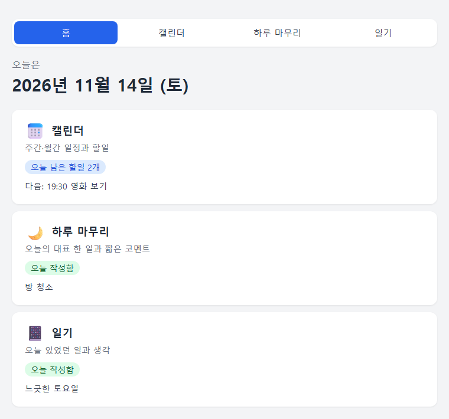
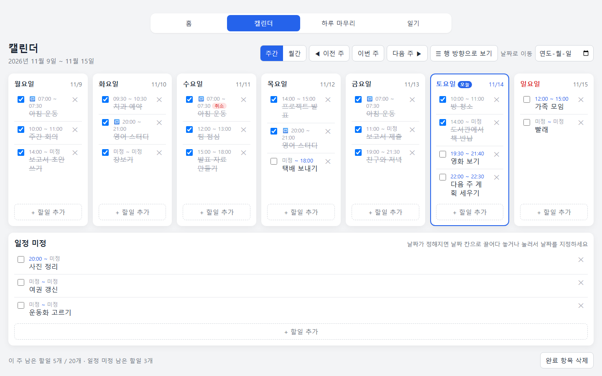
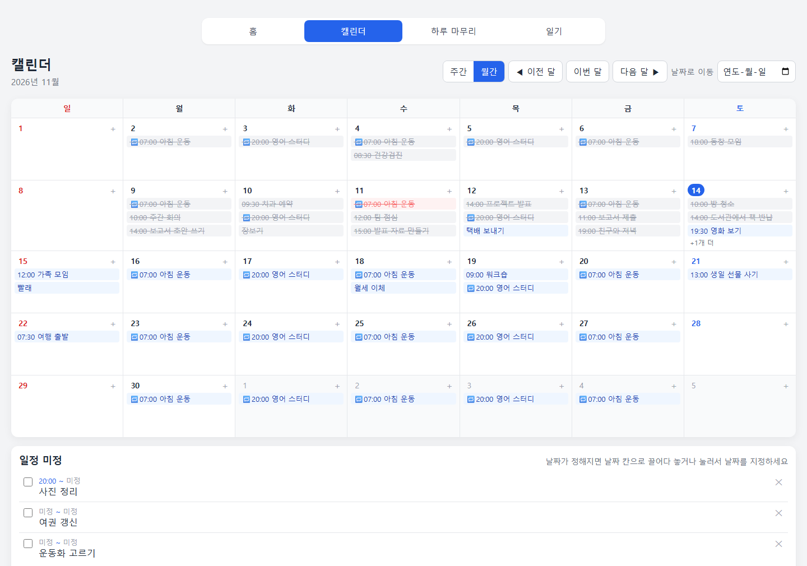
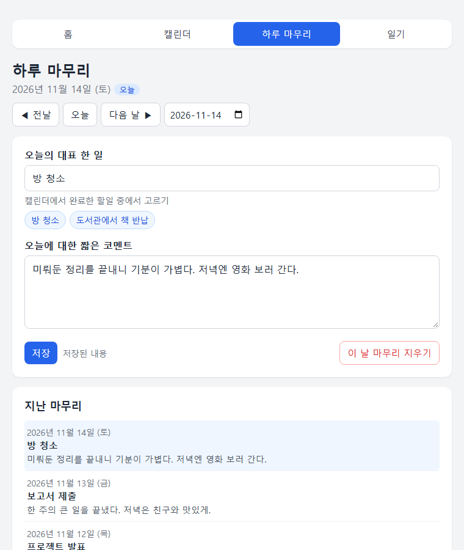
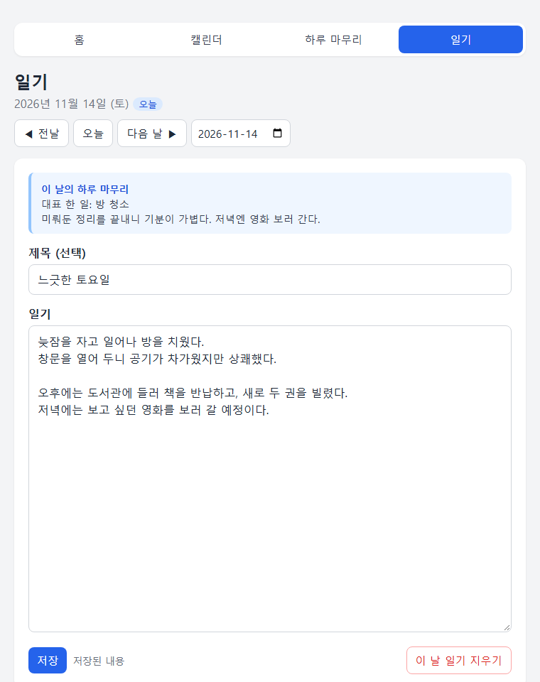

# C.T (Custom Today)

하루를 계획하고, 마무리하고, 기록하는 개인용 웹앱입니다.
**캘린더 · 하루 마무리 · 일기** 세 가지 기능이 있고, 메인 화면에서 각각으로 이동합니다.

👉 **바로 쓰기: https://doa-ddaram.github.io/C.T/** (휴대폰에서도 열 수 있습니다)

설치나 회원가입 없이 html 파일을 브라우저에서 열기만 하면 됩니다. 모든 데이터는 내 브라우저 안에만 저장되고, 외부로 보내지 않습니다.

## 기능

> 아래 사진 속 일정과 글은 설명을 위해 넣은 예시 데이터입니다.

### 🏠 메인 (`index.html`)



- 오늘 날짜를 보여줍니다.
- 카드마다 오늘 상태를 한눈에 보여줍니다.
  - 캘린더: 오늘 남은 할일 개수와 다음 할일
  - 하루 마무리 · 일기: 오늘 썼는지와 내용 앞부분

### 📅 캘린더 (`calendar.html`)





- **주간 보기**: 월~일 7칸에 할일을 시작 시간 순으로 보여줍니다. 오늘 칸을 강조하고, 가로(열)/세로(행) 배치를 바꿀 수 있습니다.
- **월간 보기**: 날짜 칸마다 할일을 3개까지 보여주고, 넘치면 `+N개 더`로 표시합니다. 날짜를 누르면 그 주의 주간 보기로 이동합니다. 휴대폰에서는 날짜를 누르면 달력 아래에 그날 할일이 바로 나오고, 거기서 추가·수정할 수 있습니다.
- **일정 미정 칸**: 날짜가 아직 정해지지 않은 할일을 모아 둡니다. 끌어다 놓으면 날짜로 옮기거나 다시 일정 미정으로 되돌릴 수 있습니다.
- **시작 · 끝 시간**: 둘 다 따로 `미정`으로 둘 수 있습니다. (예: `14:00 ~ 미정`)
- **반복 일정**: 요일, 간격(매주~4주마다), 기간(최대 3년)을 정해 반복 일정을 만듭니다. 한 날짜만 고치거나 `이번만 취소`할 수도 있습니다.
- 완료 체크, 삭제, 완료 항목 한꺼번에 삭제, 날짜로 바로 이동 기능이 있습니다.

### 🌙 하루 마무리 (`review.html`)



- 날짜마다 **오늘의 대표 한 일**과 **오늘에 대한 짧은 코멘트**를 남깁니다.
- 그날 캘린더에서 완료한 할일이 버튼으로 나와서, 누르면 대표 한 일 칸에 바로 들어갑니다.
- 지난 마무리를 목록으로 다시 볼 수 있습니다.

### 📔 일기 (`diary.html`)



- 날짜마다 제목(선택)과 본문으로 일기를 씁니다.
- 그날 쓴 하루 마무리가 본문 위에 함께 보입니다.
- 지난 일기를 목록으로 다시 볼 수 있습니다.

하루 마무리와 일기는 글을 쓰다 잠깐 멈추면 **자동으로 저장**됩니다. 지울 때는 확인 창이 한 번 더 뜹니다.

## 사용 방법

1. 이 저장소의 파일을 내려받습니다. (`Code` → `Download ZIP`)
2. **4개의 html 파일을 같은 폴더에 둔 채로** `index.html`을 브라우저에서 엽니다.
3. 위쪽 메뉴 `홈 | 캘린더 | 하루 마무리 | 일기`로 페이지를 오갑니다.

> 각 파일은 따로 열어도 기본 기능은 동작합니다. 하지만 페이지끼리 데이터를 이어서 보여주는 기능(하루 마무리의 완료 할일 버튼, 메인의 오늘 요약 등)을 쓰려면 4개 파일이 같은 폴더(같은 주소)에 있어야 합니다.

### 휴대폰에서 쓰기
휴대폰에서는 파일을 내려받지 말고 https://doa-ddaram.github.io/C.T/ 를 여세요. 브라우저 메뉴의 **홈 화면에 추가**를 누르면 앱처럼 아이콘으로 열 수 있습니다.

> 휴대폰 브라우저는 내려받은 html 파일을 잘 못 열거나, 파일마다 저장공간을 따로 쓸 수 있습니다.

## 데이터 저장

모든 데이터는 브라우저의 `localStorage`에 저장됩니다.

| 키 | 내용 |
|---|---|
| `calendarTodos` | 캘린더 할일 |
| `calendarSeries` | 반복 일정 설정 |
| `calendarView`, `calendarLayout` | 주간/월간, 행/열 보기 설정 |
| `dailyReviews` | 하루 마무리 |
| `diaryEntries` | 일기 |

- 데이터는 **지금 쓰는 브라우저와 기기에만** 있습니다. 다른 기기나 다른 브라우저와 자동으로 이어지지 않습니다.
- 브라우저의 "인터넷 사용 기록 / 사이트 데이터 삭제"를 하면 데이터도 함께 지워질 수 있으니 주의하세요.
- html 파일을 다른 사람에게 줘도 내 일정이나 일기는 따라가지 않습니다. 받은 사람은 빈 상태로 시작합니다.
- 예전 할일 목록(`todos` 키) 데이터가 있으면 처음 실행할 때 캘린더의 일정 미정 칸으로 옮깁니다. 원래 데이터는 지우지 않습니다.

## 파일 구성

```
index.html     메인
calendar.html  캘린더
review.html    하루 마무리
diary.html     일기
AGENTS.md      AI 에이전트용 작업 규칙 · 기능 요구사항 · 데이터 구조
README.md      이 문서
screenshots/   README에 쓰는 화면 예시 사진
```

- 빌드 도구, 프레임워크, 외부 라이브러리, 서버 없이 동작합니다.
- 각 파일 하나에 HTML, CSS, JavaScript가 모두 들어 있습니다.
- 자세한 기능 요구사항과 데이터 형식은 [`AGENTS.md`](AGENTS.md)에 정리되어 있습니다. 코드를 고칠 때는 이 문서도 함께 고쳐 주세요.
